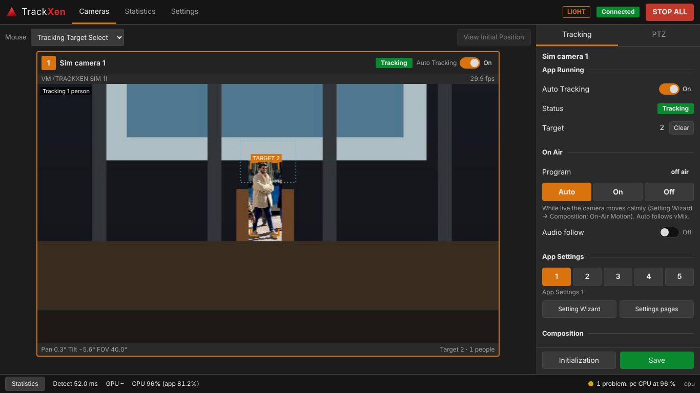
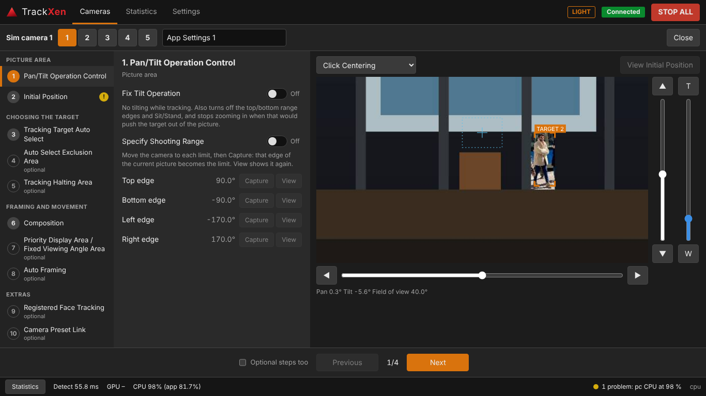

<p align="center">
  
</p>

<h1 align="center">TrackXen</h1>

<p align="center">
  Automatic speaker tracking for PTZ cameras: up to four cameras, one Windows PC, run from any browser.
</p>



TrackXen is a camera tracker: it points PTZ cameras at the people on stage by itself. Each camera
follows its own person, keeps them framed the way it was set up, and moves calmly while it is on air.
It was made for live church services and works anywhere speakers move on a stage: lectures,
conferences, panels.

## Features

- **Tracking that holds on to the right person:** pose detection on the GPU (YOLO26-pose with
  TensorRT, CUDA or the CPU), with auto select, a click to choose the target, and face recognition
  for registered people.
- **Smooth camera moves:** a steady walk is followed in one movement, and **Pan/Tilt Smoothness**
  sets how softly the camera starts, stops and changes speed. The joystick, Stream Deck and API moves
  are smoothed too; STOP ALL always stops at once.
- **Areas fixed to the room:** shooting range, initial position, priority display area, fixed
  viewing angles for a podium, auto select and exclusion areas, and halting areas.
- **5 App Settings per camera:** complete tracking setups ("Sermon", "Worship", "Panel") switched
  live, from Stream Deck, or by recalling a camera preset.
- **Auto Framing:** groups of people, space in front of the face, closer when someone sits.
- **Calm on air:** a camera on Program (vMix tally, or the On Air switch) moves calmly and doesn't jump
  to a new target.
- **Run from anywhere on the network:** the PC, a tablet or a phone, with an optional PIN.
- **Built for a live show:** a red STOP ALL on every screen, a watchdog that stops cameras when the
  picture stops, problem lights, statistics, logs and show files.
- **Bitfocus Companion and an HTTP API** for Stream Deck buttons.
- **Updates from GitHub** inside the program: Settings → System → Updates.



## What you need

- **Windows 10 or 11 PC**, ideally with an NVIDIA RTX graphics card (it runs on the processor without
  one, but only follows people slowly).
- **Cameras:** BirdDog P400 (VISCA over IP with FreeD position data) or PTZOptics G2 (VISCA over IP or
  TCP); other VISCA-over-IP cameras with a speed table of their own.
- **Video:** NDI, an HDMI/SDI capture card, or the camera's own network stream (RTSP).
- **Optional:** vMix (tally), Bitfocus Companion.

## Install

1. Download `TrackXen-Setup-<version>.exe` from the
   [latest release](https://github.com/anccon343/TrackXen/releases/latest) and run it.
2. On its first start TrackXen downloads NVIDIA's libraries for the PC's graphics card (about
   1.5 GB, once), then opens in the browser.
3. Add the cameras on the welcome page, then set up a venue with the Setting Wizard.

New versions install from **Settings → System → Updates**. Every push to `main` builds a new release
on GitHub (`.github/workflows/release.yml`).

## Documentation

- [User guide](docs/user-guide.md): installing, everyday use, setting up a venue, faces, vMix, Stream
  Deck buttons, troubleshooting.
- [Features](docs/features.md): every feature and setting.
- [Camera lab tools](tools/README.md): measuring the cameras (speeds, FreeD, delays).
- [Development notes](docs/development/): the plan, the research behind it, and a dated log of what was
  built and measured.

## Development

Windows, Python 3.12, an NVIDIA GPU for real speed:

```
py -3.12 -m venv .venv
.venv\Scripts\python -m pip install -r requirements-dev.txt -c requirements-lock.txt
cd ui && npm install && npm run build && cd ..
.venv\Scripts\python -m pytest
```

The models aren't in git. Export them with PyTorch and Ultralytics (`requirements-dev.txt`) and
`tools\export_models.py`; the face models come from `tools\get_face_models.py`.

- With cameras: `.venv\Scripts\python -m trackxen`, then open http://127.0.0.1:8090.
- Without cameras: `tools\sim_camera.py` (a virtual camera with a walking speaker) and
  `python -m trackxen --sim`.
- `tools\motion_bench.py` measures how smoothly the cameras follow (closed loop, virtual time).

`powershell -ExecutionPolicy Bypass -File packaging\build.ps1` builds the web UI, `dist\TrackXen`
(PyInstaller) and, with Inno Setup 6, the setup program. NVIDIA's CUDA, cuDNN and TensorRT libraries
aren't in it: the program downloads the ones a PC needs on its first start.

## Safety

TrackXen moves cameras by itself. Whenever it runs in front of an audience, keep someone able to press
**STOP ALL**.

## License

TrackXen is free software under the [GNU Affero General Public License v3.0 or later](LICENSE).
Third-party software and models it includes, and their licences, are listed in
[LICENSE-NOTICE.txt](LICENSE-NOTICE.txt).
